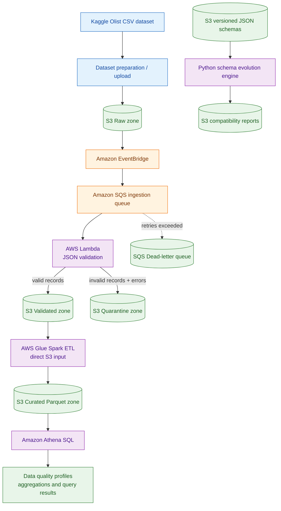
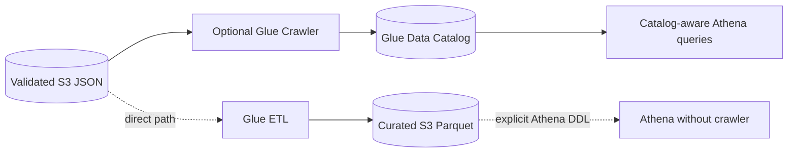

# 🇧🇷 Brazilian E-Commerce Data Quality & Schema Evolution Platform

<p align="center">
  <strong>End-to-end AWS data engineering platform for ingestion, data validation, schema evolution, Spark ETL, and SQL analytics on the Olist Brazilian E-Commerce dataset.</strong>
</p>

<p align="center">
  
  
  
  
  
  
</p>

---

## 🌟 What this project demonstrates

A practical data platform with:

- Event-driven ingestion using **S3, EventBridge, SQS, and Lambda**.
- Data quality validation and valid/quarantine routing.
- Versioned JSON schemas and schema evolution reporting.
- AWS Glue Spark ETL that reads and writes **direct S3 paths**.
- Curated Parquet data layout for analytics.
- Athena SQL examples for profiling curated output.
- Terraform-managed infrastructure and repeatable test commands.

> **Honest implementation status:** Infrastructure and code have been added and the ingestion path / schema report flow have been exercised as described below. The Glue crawler API was denied at account level in the development account. Glue ETL job deployment was reported, but a successful Glue job run and Athena query execution have not yet been evidenced in this project conversation. Therefore, this README documents those as runnable examples and verification steps, not as completed live results.

## 🧭 Architecture

### Main data flow



### Optional crawler branch

The Glue Crawler is optional for this design. The ETL and Athena examples use direct S3 paths and explicit SQL table DDL, so a crawler is not required.



The crawler Terraform resource is kept opt-in in `terraform/glue_crawler_optional.tf` and defaults to disabled. The development account returned `AccessDeniedException: Account 553607360155 is denied access` for `CreateCrawler`. Enable it only after AWS confirms crawler access is available.

## 🗃️ Data source and attribution

**Dataset:** [Brazilian E-Commerce Public Dataset by Olist on Kaggle](https://www.kaggle.com/datasets/olistbr/brazilian-ecommerce)

The dataset contains approximately 100,000 orders from 2016–2018 and related customer, seller, product, payment, review, order-item, and geolocation tables. The publisher describes the commercial data as anonymized.

**Attribution:** Olist — *Brazilian E-Commerce Public Dataset by Olist*, published on Kaggle.

**License shown on Kaggle:** [CC BY-NC-SA 4.0](https://creativecommons.org/licenses/by-nc-sa/4.0/). This is an attribution, non-commercial, share-alike license. Review the dataset page and license before redistribution or commercial use. The dataset's terms apply to the data; they are separate from the license for this repository's code.

Repository source-data directory: [`datasets/source/`](datasets/source/). It contains Olist CSV files such as `olist_customers_dataset.csv`, `olist_orders_dataset.csv`, `olist_order_items_dataset.csv`, `olist_products_dataset.csv`, `olist_sellers_dataset.csv`, payment/review/geolocation files, and category translations.

The customer data fields used in the customer-focused validation flow are:

| Olist CSV column | Pipeline field |
|---|---|
| `customer_id` | `customer_id` |
| `customer_city` | `customer_city` |
| `customer_state` | `customer_state` |

The small files under `terraform/valid_customer.json`, `terraform/invalid_customer.json`, and `datasets/test_data/` are test fixtures. They should not be described as the complete Kaggle dataset.

## 🪣 Data lake zones

| Zone | Purpose |
|---|---|
| Raw | Landing zone for incoming source/test JSON |
| Schemas | Versioned customer JSON Schema files |
| Validated | JSON records passing ingestion validation |
| Quarantine | Invalid records accompanied by validation errors |
| Reports | Schema compatibility / evolution reports |
| Curated | Transformed Parquet datasets for analytics |

All S3 bucket names are generated by Terraform with a unique suffix. Use Terraform outputs rather than copying a bucket name from another deployment.

## ⚡ Ingestion and validation

1. A JSON file is uploaded to the raw S3 bucket.
2. The S3 EventBridge event is matched by an EventBridge rule.
3. EventBridge sends a message to the SQS ingestion queue.
4. Lambda reads the source object and validates required customer fields.
5. Valid data is written to the validated S3 prefix.
6. Invalid records are written to the quarantine prefix with record-level errors.
7. SQS retries failed messages and routes messages to the DLQ according to the configured redrive policy.

### Sample fixtures

Valid sample:

```json
{
  "customer_id": "customer-001",
  "customer_city": "sao paulo",
  "customer_state": "sp"
}
```

Invalid sample (empty city):

```json
{
  "customer_id": "customer-002",
  "customer_city": "",
  "customer_state": "RJ"
}
```

### Ingestion test commands (Windows CMD)

Run from the `terraform` directory. Replace bucket names only when necessary; the commands below show the development naming convention reported during implementation.

```cmd
aws s3 cp valid_customer.json s3://dq-platform-raw-791c8f1e/test/valid_customer.json --profile admin --region us-west-2
aws s3 cp invalid_customer.json s3://dq-platform-raw-791c8f1e/test/invalid_customer.json --profile admin --region us-west-2

aws s3 ls s3://dq-platform-validated-791c8f1e/processed/ --recursive --profile admin --region us-west-2
aws s3 ls s3://dq-platform-quarantine-791c8f1e/quarantine/ --recursive --profile admin --region us-west-2
```

CloudWatch log inspection:

```cmd
aws logs describe-log-streams --log-group-name /aws/lambda/dq-platform-ingestion --order-by LastEventTime --descending --max-items 5 --profile admin --region us-west-2
```

**Observed during development:** valid JSON uploads were processed by the S3 → EventBridge → SQS → Lambda flow, and objects appeared in the validated bucket. The invalid fixture was uploaded, but its quarantine listing was not independently confirmed in the reported session; use the command above to verify it in your own account.

## 🔁 Schema evolution

The project stores customer schemas as versioned JSON files:

```text
terraform/schemas/customer/
├── v1/schema.json
├── v2/schema.json
└── v3/schema.json
```

The Python engine compares versions and detects field addition/removal, requiredness changes, type changes, enum changes, and selected constraints.

**Observed v2 → v3 comparison:**

| Detected change | Classification by current engine |
|---|---|
| `customer_segment` became required | Breaking |
| `customer_city` removed | Breaking |
| `customer_id` minLength constraint removed | Review required |
| `customer_state` minLength constraint removed | Review required |
| `customer_state` maxLength constraint removed | Review required |

The run returned `compatible: false`. A timestamped JSON report was written to the S3 reports bucket.

This is a structural change classifier, not a complete formal compatibility proof for every JSON Schema feature. Directional backward/forward compatibility and complex schema constructs require additional implementation and tests.

Run locally:

```cmd
python -m py_compile advanced_schema_evolution.py
python advanced_schema_evolution.py
python schema_registry_service.py
```

## 🔥 Glue ETL: JSON to Parquet

The Glue Spark job is configured to read directly from the validated S3 prefix:

```text
s3://<validated-bucket>/processed/
```

It performs the following transformations:

- Reads JSON with Spark.
- Trims `customer_id` and `customer_city`.
- Trims and uppercases `customer_state`.
- Checks required fields and counts rejected rows.
- Adds `processed_at` and `processing_date`.
- Writes valid rows as Parquet partitioned by `processing_date`.

Output path:

```text
s3://<curated-bucket>/customer/
```

Implementation: [`terraform/scripts/customer_etl.py`](terraform/scripts/customer_etl.py) and [`terraform/glue_etl.tf`](terraform/glue_etl.tf).

### Glue job validation commands

```cmd
aws glue get-job --job-name dq-platform-customer-etl --profile admin --region us-west-2
aws glue start-job-run --job-name dq-platform-customer-etl --profile admin --region us-west-2
```

Copy the `JobRunId` returned by the start command:

```cmd
aws glue get-job-run --job-name dq-platform-customer-etl --run-id <JOB_RUN_ID> --query "JobRun.JobRunState" --output text --profile admin --region us-west-2
aws s3 ls s3://<CURATED_BUCKET>/customer/ --recursive --profile admin --region us-west-2
```

Expected successful result: job state `SUCCEEDED` and one or more `.parquet` objects beneath a `processing_date=YYYY-MM-DD/` partition. A Terraform apply creating the job is not equivalent to a successful job execution.

## 🧮 Athena analytics examples

The repository includes [`athena/customer_analytics.sql`](athena/customer_analytics.sql). It shows how to create an Athena external table over curated Parquet using explicit DDL and partition projection. This path does not need a Glue Crawler.

The SQL examples cover:

1. Customer record volumes by processing date.
2. Distinct customer counts.
3. Customer distribution by state.
4. City/state distribution.
5. Null and blank checks on required fields.

### Example query

```sql
SELECT
    customer_state,
    COUNT(*) AS customer_count
FROM dq_platform_analytics.customer_curated
GROUP BY customer_state
ORDER BY customer_count DESC
LIMIT 20;
```

Before running the SQL:

- Replace `<CURATED_BUCKET>` in the DDL with the bucket name from Terraform.
- Confirm the Glue job has written Parquet files with the expected columns and `processing_date` partition.
- Configure an Athena query-results S3 location.
- Ensure the querying principal can read the curated S3 path and write/read the Athena query-results path.

**Query output:** no live Athena result is embedded here because an Athena query execution and result set have not yet been provided/verified. The SQL is a runnable example, not a fabricated result screenshot.

## 🖼️ Pipeline and output visuals

The Mermaid diagrams above render the architecture directly in GitHub. For real execution screenshots, capture and add your own AWS Console/CLI evidence after running the corresponding tests:

| Evidence image | What to capture |
|---|---|
| S3 ingestion | Raw upload and validated/quarantine object listings |
| Lambda | CloudWatch log entries with valid/invalid counts |
| Schema evolution | Terminal output and saved report JSON |
| Glue ETL | Glue job run details showing `SUCCEEDED` |
| Curated output | S3 listing showing Parquet files and date partitions |
| Athena | Query editor with SQL and actual result grid |

Suggested image directory: `docs/images/`. Use screenshots from your own account, hide account IDs and sensitive information, and do not use placeholder screenshots as proof of execution.

## 🧪 End-to-end test guide

See [`docs/END_TO_END_TEST.md`](docs/END_TO_END_TEST.md) for the complete command-by-command test flow from sample JSON upload through Lambda validation, schema evolution, Glue job execution, and Athena.

## 🧱 Infrastructure and repository layout

```text
.
├── datasets/
│   ├── source/                  # Olist source CSV files
│   ├── schemas/                 # Dataset schema references
│   └── test_data/               # Small JSONL fixtures
├── terraform/
│   ├── modules/s3/              # Reusable S3 bucket module
│   ├── lambda/app.py            # SQS-triggered Lambda
│   ├── scripts/customer_etl.py  # Glue Spark ETL
│   ├── schemas/customer/        # Customer schema v1/v2/v3
│   ├── main.tf                  # S3 data zones
│   ├── eventing.tf              # EventBridge and SQS
│   ├── lambda.tf                # Lambda and SQS event mapping
│   ├── glue.tf                  # Glue database and crawler role policy
│   ├── glue_etl.tf              # Direct-S3 Glue ETL job
│   └── glue_crawler_optional.tf # Opt-in crawler resource
├── glue/local_spark/            # Local PySpark validation modules
├── athena/
│   └── customer_analytics.sql   # Athena DDL and analysis queries
├── docs/
│   ├── DATA_SOURCE.md
│   └── END_TO_END_TEST.md
├── schema_evolution.py
├── schema_registry_service.py
└── README.md
```

## ✅ Implementation and verification matrix

| Component | Implementation | Validation evidence / state |
|---|---|---|
| S3 raw/schema/validated/quarantine/reports zones | Terraform | Deployed and configured with versioning, encryption, and public-access blocking |
| Curated S3 zone | Terraform | Deployed; versioning and AES256 encryption verified |
| EventBridge → SQS | Terraform | Deployed; event delivery exercised |
| Lambda ingestion | Python + Terraform | Valid record processing and validated S3 output observed |
| Quarantine routing | Python + Terraform | Test fixture uploaded; independently verify quarantine object listing |
| Schema versioning | JSON files in S3 | v1/v2/v3 files used by comparison service |
| Schema evolution report | Python + boto3 | v2 → v3 result and S3 report location observed |
| Glue Data Catalog database and IAM roles | Terraform | Created |
| Glue Crawler | Optional Terraform | Not created; AWS CreateCrawler returned account-level AccessDenied |
| Glue ETL job definition | Python + Terraform | Deployment reported; confirm live job exists |
| Glue ETL execution | AWS Glue | Awaiting verified JobRunState = SUCCEEDED |
| Curated Parquet objects | S3 | Awaiting post-run object verification |
| Athena DDL and SQL | SQL file | Examples added; live query result not yet verified |

## 🔐 Security and operational notes

- S3 bucket public access is blocked.
- S3 bucket versioning and AES256 server-side encryption are enabled.
- Bucket ownership controls use BucketOwnerEnforced.
- Lambda and Glue use IAM execution roles.
- Never commit AWS credentials, Kaggle API tokens, account-sensitive outputs, Terraform state, or local plan files.
- The current Glue ETL uses append mode; make it idempotent before repeated production runs to avoid duplicate output.
- Add automated test coverage, deterministic output keys, robust quarantine persistence, schema contract tests, CloudWatch alarms, and cost controls before production use.

## 🗺️ Roadmap

- [x] Provision S3 data lake zones with Terraform.
- [x] Implement S3 → EventBridge → SQS → Lambda ingestion.
- [x] Exercise valid JSON ingestion and validated output.
- [x] Implement versioned JSON schemas and S3 schema reports.
- [x] Detect structural schema changes between v2 and v3.
- [x] Provision curated S3 storage.
- [x] Add direct-S3 Glue ETL job code and Terraform configuration.
- [x] Add Athena DDL and example analytical SQL.
- [ ] Independently verify invalid-record quarantine output.
- [ ] Run Glue ETL and capture successful job-run evidence.
- [ ] Verify Parquet output in curated S3.
- [ ] Execute Athena SQL and capture real query output.
- [ ] Enable optional crawler only if AWS account restriction is lifted.
- [ ] Add idempotency, CI tests, monitoring, and operational alerting.

---

<p align="center">
  <strong>Built with AWS, Terraform, Python, Spark, and SQL — from raw e-commerce data to validated and analytics-ready datasets.</strong>
</p>
