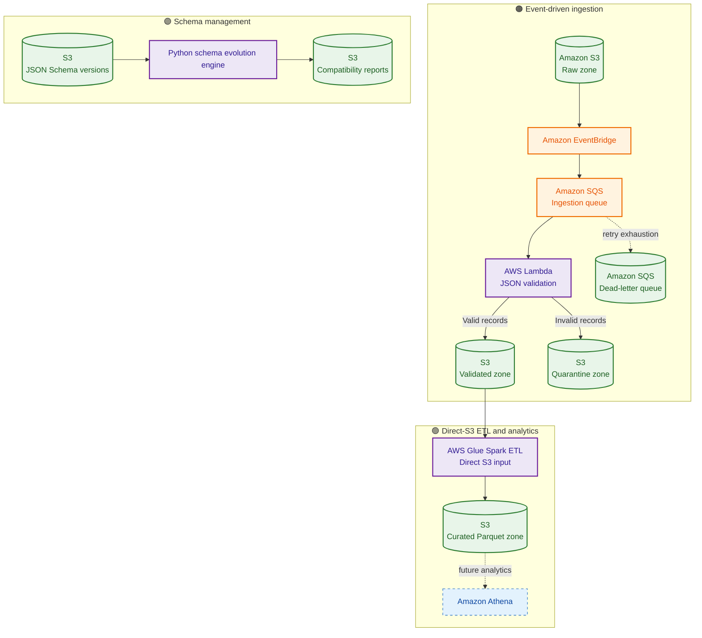

# 🇧🇷 Brazilian E-Commerce — Data Quality & Schema Evolution Platform

<p align="center">
  <strong>An AWS-based, event-driven data engineering platform for validating customer data, tracking schema changes, and preparing analytics-ready datasets.</strong>
</p>

<p align="center">
  
  
  
  
  
  
</p>

---

## 📌 Project Overview

This project builds a data quality platform for Brazilian e-commerce customer data. It uses an event-driven AWS ingestion pipeline, schema version comparison, and an S3-based data lake layout.

The platform is designed to:

- Ingest JSON files from an S3 raw-data zone.
- Trigger processing through Amazon EventBridge and Amazon SQS.
- Validate required customer fields with an AWS Lambda function.
- Separate valid and invalid records into dedicated S3 zones.
- Store versioned JSON schemas and generate schema evolution reports.
- Transform validated JSON data into partitioned Parquet using AWS Glue ETL.
- Prepare curated data for downstream analytics with Amazon Athena.

> **Implementation note:** The Glue Crawler creation API currently returns an account-level `AccessDeniedException`. The current ETL design therefore reads and writes direct S3 paths and does not depend on a crawler or manually created Catalog tables. Glue ETL job execution and Athena integration remain verification / follow-up tasks.

## 🏗️ Architecture

The diagram below shows the implemented ingestion and schema-management paths, plus the planned direct-S3 ETL and analytics path.



### Data zones

| Zone | Purpose |
|---|---|
| **Raw** | Original incoming customer JSON files |
| **Schemas** | Versioned JSON Schema definitions |
| **Validated** | Records passing required-field checks |
| **Quarantine** | Invalid records and validation errors |
| **Reports** | Schema evolution / compatibility reports |
| **Curated** | Analytics-ready Parquet output |

## 🧰 Technology Stack

| Area | Services / Tools |
|---|---|
| Infrastructure as Code | Terraform |
| Object storage | Amazon S3 |
| Event routing | Amazon EventBridge |
| Message queue | Amazon SQS + DLQ |
| Ingestion and validation | AWS Lambda, Python 3.12 |
| Schema management | JSON Schema, Python, boto3 |
| Transformation | AWS Glue Spark ETL, PySpark |
| Analytics (next integration) | Amazon Athena |
| Monitoring | Amazon CloudWatch |

## 🔍 Schema Evolution

Schema versions are stored in S3 under a dataset/version layout:

```text
schemas/
└── customer/
    ├── v1/schema.json
    ├── v2/schema.json
    └── v3/schema.json
```

The Python comparison engine detects structural changes such as:

- Added and removed fields.
- Fields becoming required or optional.
- Type changes.
- Enum changes.
- Constraint changes such as minimum and maximum lengths.

Changes are classified into **breaking**, **review required**, and **non-breaking** categories. Reports are written to the S3 reports bucket.

The current compatibility classification is a structural analysis, not a complete proof of JSON Schema compatibility. Directional backward/forward compatibility and broader JSON Schema constructs are future improvements.

## ⚙️ Ingestion Flow

1. A JSON object is uploaded to the raw S3 bucket.
2. S3 emits an event through EventBridge.
3. EventBridge sends a message to the SQS ingestion queue.
4. Lambda reads the object and validates required customer fields:
   - `customer_id`
   - `customer_city`
   - `customer_state`
5. Valid records are written to the validated bucket.
6. Invalid records are written to the quarantine bucket with error details.
7. Failed messages can be retried and eventually routed to the DLQ.

## 🧪 Glue ETL Design

The Glue Spark job is configured to read directly from:

```text
s3://<validated-bucket>/processed/
```

It standardizes customer identifiers and city values, uppercases state values, checks required fields, adds processing metadata, and writes partitioned Parquet to:

```text
s3://<curated-bucket>/customer/
```

The job uses direct S3 paths. It does **not** require a Glue Crawler or Data Catalog table.

## 📁 Repository Layout

```text
.
├── terraform/
│   ├── modules/s3/              # Reusable S3 bucket module
│   ├── lambda/app.py            # SQS-triggered ingestion Lambda
│   ├── scripts/customer_etl.py  # Glue Spark ETL script
│   ├── schemas/customer/        # Versioned customer schemas
│   ├── main.tf                  # S3 data lake resources
│   ├── eventing.tf              # EventBridge and SQS
│   ├── lambda.tf                # Lambda and event source mapping
│   ├── glue.tf                  # Glue catalog database and IAM setup
│   ├── glue_etl.tf              # Glue ETL job and execution role
│   ├── outputs.tf
│   └── variables.tf
├── schema_evolution.py          # Basic schema comparison
├── schema_registry_service.py   # S3 schema discovery and report writer
└── README.md
```

## 🚀 Deployment

### Prerequisites

- AWS account with permissions for the required services.
- AWS CLI configured with a profile.
- Terraform installed.
- Python 3.12.
- AWS region configured for the deployment.

### 1. Clone the repository

```bash
git clone https://github.com/SwekcchaCornicle/Brazilian-E-Commerce-Data-Engineering.git
cd Brazilian-E-Commerce-Data-Engineering/terraform
```

### 2. Initialize and validate Terraform

```bash
terraform init
terraform fmt
terraform validate
terraform plan
```

Review the plan before applying infrastructure:

```bash
terraform apply
```

### 3. Upload a sample JSON object

Use the bucket name emitted by Terraform:

```bash
aws s3 cp valid_customer.json s3://<raw-bucket>/test/valid_customer.json
```

The EventBridge → SQS → Lambda pipeline should process the object and write valid records to the validated zone.

### 4. Run schema comparison

From the directory containing the schema comparison scripts, configure AWS credentials and run:

```bash
python schema_evolution.py
python schema_registry_service.py
```

Check the generated compatibility report in the S3 reports bucket.

> Use your own AWS profile, region, and Terraform outputs. Do not commit AWS credentials, Terraform state files, generated ZIP packages, or sensitive data to Git.

## 📊 Current Implementation Status

| Component | Status |
|---|---|
| S3 data lake zones and bucket security | ✅ Deployed |
| EventBridge → SQS routing | ✅ Deployed |
| Lambda ingestion and valid-record processing | ✅ Tested |
| Invalid-record quarantine path | 🟡 Requires final verification |
| Versioned schemas in S3 | ✅ Implemented |
| Schema comparison and S3 reports | ✅ Tested |
| Advanced structural change classification | ✅ Initial version working |
| Glue Data Catalog database and IAM role | ✅ Created |
| Glue Crawler | ⛔ Account-level access denied |
| Direct-S3 Glue ETL job configuration | 🟡 Deployed; execution needs verification |
| Curated Parquet output | 🟡 Needs successful job-run verification |
| Athena analytics | 🔜 Planned |
| Production hardening and monitoring | 🔜 Planned |

## 🔐 Security and Engineering Notes

- S3 buckets are configured with public access blocked.
- S3 bucket versioning and AES256 server-side encryption are enabled.
- S3 object ownership is configured as BucketOwnerEnforced.
- IAM roles are used for Lambda and Glue execution.
- Keep credentials outside source control.
- Before production use, add deterministic/idempotent output keys, retry-safe writes, stronger schema validation, automated tests, and operational alarms.

## 🗺️ Roadmap

- [x] Provision S3 data zones with Terraform.
- [x] Build S3 → EventBridge → SQS → Lambda ingestion.
- [x] Validate customer records and write valid output.
- [x] Store schema versions and generate evolution reports.
- [x] Build initial structural schema-change classification.
- [x] Provision a curated S3 zone.
- [x] Configure a direct-S3 Glue ETL job.
- [ ] Verify Glue ETL execution and Parquet output.
- [ ] Integrate Athena analytics.
- [ ] Add directional schema compatibility tests.
- [ ] Add automated end-to-end tests, idempotency, and monitoring.

---

<p align="center">
  <strong>Built to make data quality, schema change visibility, and reliable data pipelines part of the same workflow.</strong>
</p>
