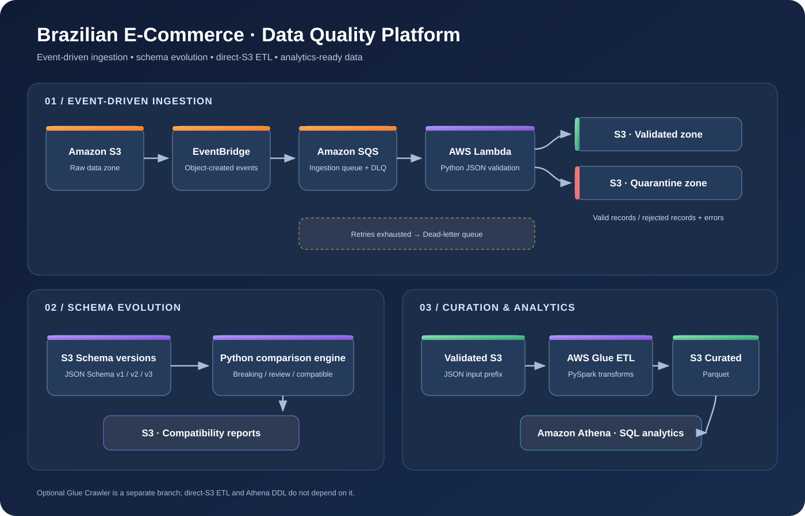
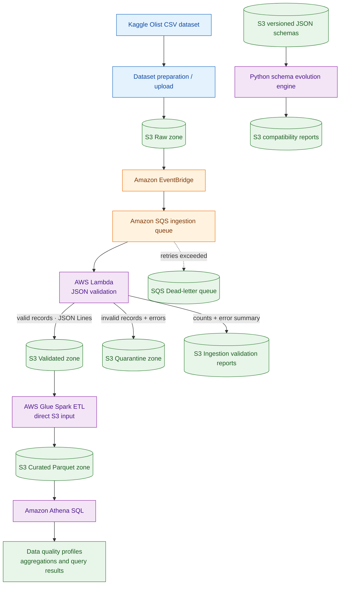
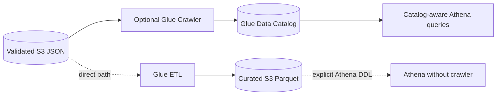
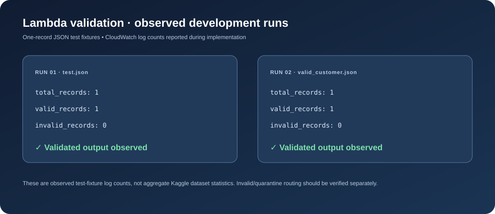
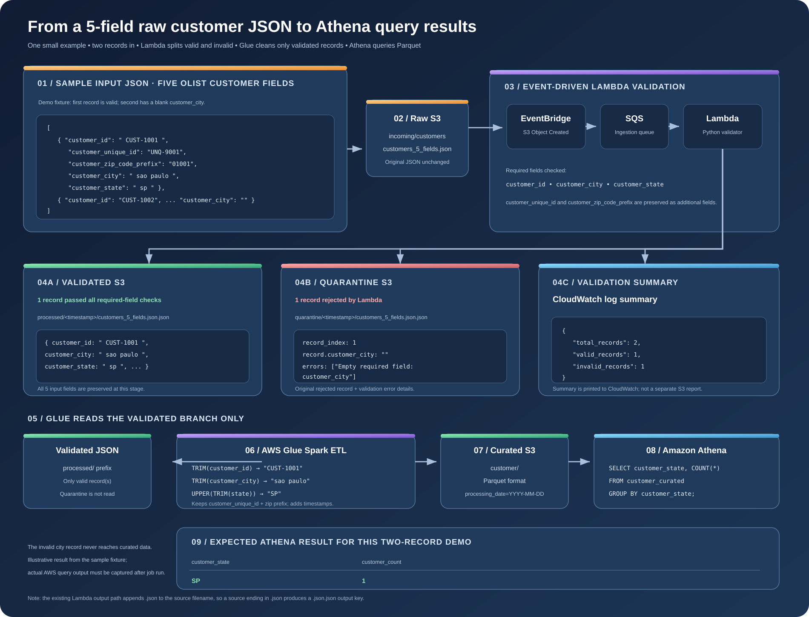
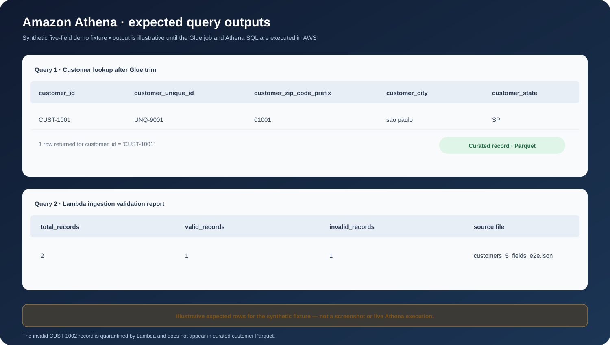

# 🇧🇷 Brazilian E-Commerce Data Quality & Schema Evolution Platform

<p align="center">
  <strong>End-to-end AWS data engineering platform for ingestion, data validation, schema evolution, Spark ETL, and SQL analytics on the Olist Brazilian E-Commerce dataset.</strong>
</p>

<p align="center">
  
  
  
  
  
  
  
</p>

---

## 🌟 What this project demonstrates

A practical data platform with:

- Event-driven ingestion using **S3, EventBridge, SQS, and Lambda**.
- Data quality validation and valid/quarantine routing.
- Versioned JSON schemas and schema evolution reporting.
- AWS Glue Spark ETL that reads and writes **direct S3 paths**.
- Curated Parquet data layout for analytics.
- Athena SQL examples for profiling curated output.
- Terraform-managed infrastructure and repeatable test commands.


## 🧭 Architecture

### Architecture image

<p align="center"></p>

### Main data flow



### Optional crawler branch

The Glue Crawler is optional for this design. The ETL and Athena examples use direct S3 paths and explicit SQL table DDL, so a crawler is not required.



The crawler Terraform resource is kept opt-in in `terraform/glue_crawler_optional.tf` and defaults to disabled. The development account returned `AccessDeniedException: Account 553607360155 is denied access` for `CreateCrawler`. Enable it only after AWS confirms crawler access is available.

## 🗃️ Data source and attribution

**Dataset:** [Brazilian E-Commerce Public Dataset by Olist on Kaggle](https://www.kaggle.com/datasets/olistbr/brazilian-ecommerce)

The dataset contains approximately 100,000 orders from 2016–2018 and related customer, seller, product, payment, review, order-item, and geolocation tables. The publisher describes the commercial data as anonymized.

**Attribution:** Olist — *Brazilian E-Commerce Public Dataset by Olist*, published on Kaggle.

**License shown on Kaggle:** [CC BY-NC-SA 4.0](https://creativecommons.org/licenses/by-nc-sa/4.0/). This is an attribution, non-commercial, share-alike license. Review the dataset page and license before redistribution or commercial use. The dataset's terms apply to the data; they are separate from the license for this repository's code.

Repository source-data directory: [`datasets/source/`](datasets/source/). It contains Olist CSV files such as `olist_customers_dataset.csv`, `olist_orders_dataset.csv`, `olist_order_items_dataset.csv`, `olist_products_dataset.csv`, `olist_sellers_dataset.csv`, payment/review/geolocation files, and category translations.

The customer data fields used in the customer-focused validation flow are:

| Olist CSV column | Pipeline field |
|---|---|
| `customer_id` | `customer_id` |
| `customer_unique_id` | `customer_unique_id` |
| `customer_zip_code_prefix` | `customer_zip_code_prefix` (kept as string to preserve leading zeroes) |
| `customer_city` | `customer_city` |
| `customer_state` | `customer_state` |

Lambda currently requires `customer_id`, `customer_city`, and `customer_state`; `customer_unique_id` and `customer_zip_code_prefix` are preserved optional attributes in this example.

The small files under `terraform/valid_customer.json`, `terraform/invalid_customer.json`, and `datasets/test_data/` are test fixtures. They should not be described as the complete Kaggle dataset.

## 🪣 Data lake zones

| Zone | Purpose |
|---|---|
| Raw | Landing zone for incoming source/test JSON |
| Schemas | Versioned customer JSON Schema files |
| Validated | JSON records passing ingestion validation |
| Quarantine | Invalid records accompanied by validation errors |
| Reports | Schema evolution reports and per-file Lambda ingestion validation reports |
| Curated | Transformed Parquet datasets for analytics |

All S3 bucket names are generated by Terraform with a unique suffix. Use Terraform outputs rather than copying a bucket name from another deployment.

## ⚡ Ingestion and validation

<p align="center"></p>

**Validation evidence:** During development, CloudWatch logs showed two separate one-record valid fixture runs with `total_records=1`, `valid_records=1`, and `invalid_records=0`. This validates the happy path for the sample fixtures; it is not a full-scale benchmark or proof of the invalid/quarantine path.

1. A JSON file is uploaded to the raw S3 bucket.
2. The S3 EventBridge event is matched by an EventBridge rule.
3. EventBridge sends a message to the SQS ingestion queue.
4. Lambda reads the source object and validates required customer fields.
5. Valid data is written to the validated S3 prefix.
6. Invalid records are written to the quarantine prefix with record-level errors.
7. SQS retries failed messages and routes messages to the DLQ according to the configured redrive policy.

### Sample fixtures

Valid sample:

```json
{
  "customer_id": "customer-001",
  "customer_city": "sao paulo",
  "customer_state": "sp"
}
```

Invalid sample (empty city):

```json
{
  "customer_id": "customer-002",
  "customer_city": "",
  "customer_state": "RJ"
}
```

### Ingestion test commands (Windows CMD)

Run from the `terraform` directory. Replace bucket names only when necessary; the commands below show the development naming convention reported during implementation.

```cmd
aws s3 cp valid_customer.json s3://dq-platform-raw-791c8f1e/test/valid_customer.json --profile admin --region us-west-2
aws s3 cp invalid_customer.json s3://dq-platform-raw-791c8f1e/test/invalid_customer.json --profile admin --region us-west-2

aws s3 ls s3://dq-platform-validated-791c8f1e/processed/ --recursive --profile admin --region us-west-2
aws s3 ls s3://dq-platform-quarantine-791c8f1e/quarantine/ --recursive --profile admin --region us-west-2
```

CloudWatch log inspection:

```cmd
aws logs describe-log-streams --log-group-name /aws/lambda/dq-platform-ingestion --order-by LastEventTime --descending --max-items 5 --profile admin --region us-west-2
```

**Observed during development:** valid JSON uploads were processed by the S3 → EventBridge → SQS → Lambda flow, and objects appeared in the validated bucket. The invalid fixture was uploaded, but its quarantine listing was not independently confirmed in the reported session; use the command above to verify it in your own account.

## 🧩 One complete example: five fields from Raw S3 to Athena

The following small fixture is designed to make the complete pipeline easy to reproduce and understand. It contains **two synthetic records** using the five customer columns from Olist's customer dataset. It is not copied from a real Kaggle customer row.

The file is committed at [`terraform/customers_5_fields_e2e.json`](terraform/customers_5_fields_e2e.json).

### Input: Raw JSON

```json
[
  {
    "customer_id": "  CUST-1001  ",
    "customer_unique_id": "UNQ-9001",
    "customer_zip_code_prefix": "01001",
    "customer_city": "  sao paulo  ",
    "customer_state": " sp "
  },
  {
    "customer_id": "CUST-1002",
    "customer_unique_id": "UNQ-9002",
    "customer_zip_code_prefix": "20010",
    "customer_city": "",
    "customer_state": "rj"
  }
]
```

### Lambda: validate and split the records

The raw object is sent through S3 → EventBridge → SQS → Lambda.

The current ingestion contract treats these three attributes as required:

- `customer_id`
- `customer_city`
- `customer_state`

The other two Olist attributes, `customer_unique_id` and `customer_zip_code_prefix`, are retained and passed downstream. ZIP prefix is handled as a string to preserve leading zeroes.

For this fixture, the expected validation decision is:

| Record | Result | Reason |
|---|---|---|
| `CUST-1001` | ✅ Validated | All required fields are present and non-blank |
| `CUST-1002` | ❌ Quarantined | `customer_city` is blank |

**Validated S3 output** (one JSON object per line):

```json
{"customer_id":"  CUST-1001  ","customer_unique_id":"UNQ-9001","customer_zip_code_prefix":"01001","customer_city":"  sao paulo  ","customer_state":" sp "}
```

**Quarantine S3 output** (record plus error detail):

```json
{"record_index":1,"record":{"customer_id":"CUST-1002","customer_unique_id":"UNQ-9002","customer_zip_code_prefix":"20010","customer_city":"","customer_state":"rj"},"errors":["Empty required field: customer_city"]}
```

**Persistent ingestion validation report** is saved separately in the reports bucket:

```text
s3://<REPORTS_BUCKET>/ingestion-reports/<timestamp>/customers_5_fields_e2e.json.report.json
```

Example report summary (runtime timestamp and bucket names will differ):

```json
{
  "total_records": 2,
  "valid_records": 1,
  "invalid_records": 1,
  "validated_output": "s3://<VALIDATED_BUCKET>/processed/<timestamp>/customers_5_fields_e2e.json",
  "quarantine_output": "s3://<QUARANTINE_BUCKET>/quarantine/<timestamp>/customers_5_fields_e2e.json",
  "validation_errors": [
    {
      "record_index": 1,
      "errors": ["Empty required field: customer_city"]
    }
  ]
}
```

The full report also includes `created_at` and `source`. Lambda writes the report JSON to S3 and prints the per-object summary to CloudWatch Logs.

### Glue: read the same validated data and transform it

Glue reads only the validated prefix:

```text
s3://<VALIDATED_BUCKET>/processed/
```

It does not read the raw prefix or quarantine prefix. The updated Lambda writes JSON Lines (NDJSON); Glue's Spark reader consumes that format using the default JSON Lines mode.

| Field | Before Glue | After Glue |
|---|---|---|
| `customer_id` | `"  CUST-1001  "` | `"CUST-1001"` |
| `customer_unique_id` | `"UNQ-9001"` | `"UNQ-9001"` |
| `customer_zip_code_prefix` | `"01001"` | `"01001"` |
| `customer_city` | `"  sao paulo  "` | `"sao paulo"` |
| `customer_state` | `" sp "` | `"SP"` |

Glue adds `processed_at` and `processing_date`, then writes the one valid record as Parquet under:

```text
s3://<CURATED_BUCKET>/customer/processing_date=YYYY-MM-DD/
```

The quarantined CUST-1002 record is not present in curated Parquet.

### Athena: what the SQL query returns

The SQL in [`athena/customer_analytics.sql`](athena/customer_analytics.sql) defines a Parquet external table with the five customer columns and a partition projection. It also defines a JSON table over the ingestion reports prefix. Neither table requires a Glue Crawler.

Example customer lookup:

```sql
SELECT
    customer_id,
    customer_unique_id,
    customer_zip_code_prefix,
    customer_city,
    customer_state
FROM dq_platform_analytics.customer_curated
WHERE customer_id = 'CUST-1001';
```

Expected illustrative row for this fixture:

| customer_id | customer_unique_id | customer_zip_code_prefix | customer_city | customer_state |
|---|---|---|---|---|
| CUST-1001 | UNQ-9001 | 01001 | sao paulo | SP |

State aggregation:

```sql
SELECT customer_state, COUNT(*) AS customer_count
FROM dq_platform_analytics.customer_curated
GROUP BY customer_state
ORDER BY customer_count DESC;
```

Expected illustrative output for this fixture alone:

| customer_state | customer_count |
|---|---:|
| SP | 1 |

Validation report aggregation:

```sql
SELECT
    SUM(total_records) AS total_records,
    SUM(valid_records) AS valid_records,
    SUM(invalid_records) AS invalid_records
FROM dq_platform_analytics.ingestion_validation_reports;
```

Expected illustrative counts for this one input file: **2 total, 1 valid, 1 invalid**. If the tables include data from other runs, query totals will naturally be higher.

> These are deterministic expected results for the synthetic two-record fixture, not screenshots or live AWS query output. Execute the Glue job and Athena queries to capture actual job run IDs and query results. The diagram below shows the entire path.

<p align="center"></p>

### Deploy the updated implementation

The Lambda now writes the validation report to S3, so its environment and IAM policy have changed. The Glue script also now standardizes all five fields. These GitHub code changes do not update an already-running AWS Lambda/Glue job by themselves.

From the Terraform directory, review and apply the changes:

```cmd
terraform fmt
terraform validate
terraform plan -out=five-field-e2e.tfplan
terraform show -no-color five-field-e2e.tfplan
```

Review the Lambda package hash, `REPORTS_BUCKET` environment variable, reports-prefix IAM permission, Glue script object, and Glue job. Then apply the reviewed plan:

```cmd
terraform apply five-field-e2e.tfplan
```

Upload the example:

```cmd
aws s3 cp customers_5_fields_e2e.json s3://<RAW_BUCKET>/e2e/customers_5_fields_e2e.json --profile admin --region us-west-2
```

Verify all three Lambda outputs:

```cmd
aws s3 ls s3://<VALIDATED_BUCKET>/processed/ --recursive --profile admin --region us-west-2
aws s3 ls s3://<QUARANTINE_BUCKET>/quarantine/ --recursive --profile admin --region us-west-2
aws s3 ls s3://<REPORTS_BUCKET>/ingestion-reports/ --recursive --profile admin --region us-west-2
```

For the remaining Glue and Athena execution commands, see [`docs/END_TO_END_TEST.md`](docs/END_TO_END_TEST.md).

## 🔁 Schema evolution

The project stores customer schemas as versioned JSON files:

```text
terraform/schemas/customer/
├── v1/schema.json
├── v2/schema.json
└── v3/schema.json
```

The Python engine compares versions and detects field addition/removal, requiredness changes, type changes, enum changes, and selected constraints.

**Observed v2 → v3 comparison:**

| Detected change | Classification by current engine |
|---|---|
| `customer_segment` became required | Breaking |
| `customer_city` removed | Breaking |
| `customer_id` minLength constraint removed | Review required |
| `customer_state` minLength constraint removed | Review required |
| `customer_state` maxLength constraint removed | Review required |

The run returned `compatible: false`. A timestamped JSON report was written to the S3 reports bucket.

This is a structural change classifier, not a complete formal compatibility proof for every JSON Schema feature. Directional backward/forward compatibility and complex schema constructs require additional implementation and tests.

Run locally:

```cmd
python -m py_compile advanced_schema_evolution.py
python advanced_schema_evolution.py
python schema_registry_service.py
```

## 🔥 Glue ETL: JSON to Parquet

<p align="center"></p>

The Glue Spark job is configured to read directly from the validated S3 prefix:

```text
s3://<validated-bucket>/processed/
```

It performs the following transformations:

- Reads JSON with Spark.
- Trims `customer_id`, `customer_unique_id`, `customer_zip_code_prefix`, and `customer_city`.
- Trims and uppercases `customer_state`.
- Preserves `customer_zip_code_prefix` as a string, including leading zeroes.
- Checks required fields and counts rejected rows.
- Adds `processed_at` and `processing_date`.
- Writes valid rows as Parquet partitioned by `processing_date`.

Output path:

```text
s3://<curated-bucket>/customer/
```

Implementation: [`terraform/scripts/customer_etl.py`](terraform/scripts/customer_etl.py) and [`terraform/glue_etl.tf`](terraform/glue_etl.tf).

### Glue job validation commands

```cmd
aws glue get-job --job-name dq-platform-customer-etl --profile admin --region us-west-2
aws glue start-job-run --job-name dq-platform-customer-etl --profile admin --region us-west-2
```

Copy the `JobRunId` returned by the start command:

```cmd
aws glue get-job-run --job-name dq-platform-customer-etl --run-id <JOB_RUN_ID> --query "JobRun.JobRunState" --output text --profile admin --region us-west-2
aws s3 ls s3://<CURATED_BUCKET>/customer/ --recursive --profile admin --region us-west-2
```

Expected successful result: job state `SUCCEEDED` and one or more `.parquet` objects beneath a `processing_date=YYYY-MM-DD/` partition. A Terraform apply creating the job is not equivalent to a successful job execution.

## 🧮 Athena analytics examples

<p align="center"></p>

> The image shows **expected sample rows for the synthetic two-record fixture**. It is not a captured Athena execution. Replace it with a screenshot of the real query result after executing Athena, with account identifiers and sensitive details hidden.

The repository includes [`athena/customer_analytics.sql`](athena/customer_analytics.sql). It shows how to create an Athena external table over curated Parquet using explicit DDL and partition projection. This path does not need a Glue Crawler.

The SQL examples cover:

1. Look up the cleaned five-field customer record.
2. Aggregate customer counts by state.
3. Aggregate the Lambda validation report (total, valid, invalid).
4. Inspect recent per-file validation reports and S3 output paths.
5. Check for null/blank required fields in curated Parquet.

### Example query

```sql
SELECT
    customer_state,
    COUNT(*) AS customer_count
FROM dq_platform_analytics.customer_curated
GROUP BY customer_state
ORDER BY customer_count DESC
LIMIT 20;
```

Before running the SQL:

- Replace `<CURATED_BUCKET>` in the DDL with the bucket name from Terraform.
- Confirm the Glue job has written Parquet files with the expected columns and `processing_date` partition.
- Configure an Athena query-results S3 location.
- Ensure the querying principal can read the curated S3 path and write/read the Athena query-results path.

**Query output:** no live Athena result is embedded here because an Athena query execution and result set have not yet been provided/verified. The SQL is a runnable example, not a fabricated result screenshot.

## 🖼️ Pipeline and output visuals

The repository now includes reusable SVG visuals in [`docs/images/`](docs/images/):

- [Architecture overview](docs/images/architecture-overview.svg)
- [Glue ETL and Athena workflow](docs/images/etl-athena-workflow.svg)
- [Observed Lambda validation evidence](docs/images/validation-evidence.svg)
- [Athena result-grid preview](docs/images/athena-results-preview.svg)


The Mermaid diagrams above render the architecture directly in GitHub. For real execution screenshots, capture and add your own AWS Console/CLI evidence after running the corresponding tests:

| Evidence image | What to capture |
|---|---|
| S3 ingestion | Raw upload and validated/quarantine object listings |
| Lambda | CloudWatch log entries with valid/invalid counts |
| Schema evolution | Terminal output and saved report JSON |
| Glue ETL | Glue job run details showing `SUCCEEDED` |
| Curated output | S3 listing showing Parquet files and date partitions |
| Athena | Query editor with SQL and actual result grid |

Suggested image directory: `docs/images/`. Use screenshots from your own account, hide account IDs and sensitive information, and do not use placeholder screenshots as proof of execution.

## 🧪 End-to-end test guide

See [`docs/END_TO_END_TEST.md`](docs/END_TO_END_TEST.md) for the complete command-by-command test flow from sample JSON upload through Lambda validation, schema evolution, Glue job execution, and Athena.

## 🧱 Infrastructure and repository layout

```text
.
├── datasets/
│   ├── source/                  # Olist source CSV files
│   ├── schemas/                 # Dataset schema references
│   └── test_data/               # Small JSONL fixtures
├── terraform/
│   ├── modules/s3/              # Reusable S3 bucket module
│   ├── lambda/app.py            # SQS-triggered Lambda
│   ├── scripts/customer_etl.py  # Glue Spark ETL
│   ├── schemas/customer/        # Customer schema v1/v2/v3
│   ├── main.tf                  # S3 data zones
│   ├── eventing.tf              # EventBridge and SQS
│   ├── lambda.tf                # Lambda and SQS event mapping
│   ├── glue.tf                  # Glue database and crawler role policy
│   ├── glue_etl.tf              # Direct-S3 Glue ETL job
│   └── glue_crawler_optional.tf # Opt-in crawler resource
├── glue/local_spark/            # Local PySpark validation modules
├── athena/
│   └── customer_analytics.sql   # Athena DDL and analysis queries
├── docs/
│   ├── DATA_SOURCE.md
│   └── END_TO_END_TEST.md
├── schema_evolution.py
├── schema_registry_service.py
└── README.md
```

## ✅ Implementation and verification matrix

The project has implementation, deployment, and runtime-validation milestones. A source file or Terraform resource being present does not by itself prove a live AWS execution succeeded.

| Component | Code / infrastructure state | Runtime validation |
|---|---|---|
| S3 raw, schema, validated, quarantine, reports zones | ✅ Terraform deployed | ✅ Bucket security settings and use verified during development |
| Curated S3 zone | ✅ Terraform deployed | ✅ Bucket existence, versioning, and AES256 encryption verified |
| EventBridge → SQS | ✅ Terraform deployed | ✅ Event-driven ingestion exercised |
| Lambda valid-record ingestion | ✅ Implemented and deployed | ✅ Two one-record valid fixture runs observed in CloudWatch |
| Invalid-record quarantine | ✅ Validation/quarantine code implemented; five-field example added | 🟡 Confirm quarantine object with S3 listing after redeploy |
| Customer schema v1/v2/v3 | ✅ JSON files stored in S3 | ✅ Versions used in schema comparison |
| Schema evolution report | ✅ Python service and S3 report writer | ✅ v2 → v3 report generated and its S3 object verified |
| Advanced schema change classification | ✅ Implemented | ✅ v2 → v3 breaking changes and review-required changes observed |
| Glue Data Catalog database and IAM role | ✅ Terraform deployed | ✅ Creation recorded in Terraform state |
| Optional Glue Crawler | ✅ Terraform code added; disabled by default | ⛔ AWS returned account-level `CreateCrawler AccessDenied` |
| Glue ETL script and job definition | ✅ Updated for five-field JSON Lines input; deployment needs updated script upload | 🟡 Confirm job run reaches `SUCCEEDED` |
| Curated Parquet output | ✅ Write logic implemented | 🟡 Confirm actual Parquet objects in S3 |
| Athena DDL and analytics SQL | ✅ Five-field curated table and ingestion-report table examples committed | 🟡 Execute queries and capture actual result set |
| End-to-end test documentation | ✅ Runbook committed | 🟡 Complete each pending live verification item |

### What is validated today

- **Valid ingestion happy path:** sample JSON upload triggered the S3 → EventBridge → SQS → Lambda flow, and valid output was observed in the validated bucket.
- **Schema evolution:** customer v2 → v3 changes were detected; the compatibility report was saved in the S3 reports bucket.
- **Curated storage foundation:** the curated bucket was deployed and its versioning and AES256 encryption were checked.

### What still needs live runtime evidence

- Confirm an invalid fixture is present under the quarantine prefix.
- Run the deployed Glue job and record its `JobRunId` and `JobRunState=SUCCEEDED`.
- Confirm `.parquet` objects exist in the curated bucket.
- Execute Athena DDL and at least one analytical query; save a screenshot or export of the actual result grid.
- Enable the optional crawler only if AWS lifts the account-level restriction.

## 🔐 Security and operational notes

- S3 bucket public access is blocked.
- S3 bucket versioning and AES256 server-side encryption are enabled.
- Bucket ownership controls use BucketOwnerEnforced.
- Lambda and Glue use IAM execution roles.
- Never commit AWS credentials, Kaggle API tokens, account-sensitive outputs, Terraform state, or local plan files.
- The current Glue ETL uses append mode; make it idempotent before repeated production runs to avoid duplicate output.
- Add automated test coverage, deterministic output keys, robust quarantine persistence, schema contract tests, CloudWatch alarms, and cost controls before production use.

## 🗺️ Roadmap

- [x] Provision S3 data lake zones with Terraform.
- [x] Implement S3 → EventBridge → SQS → Lambda ingestion.
- [x] Exercise valid JSON ingestion and validated output.
- [x] Implement versioned JSON schemas and S3 schema reports.
- [x] Detect structural schema changes between v2 and v3.
- [x] Provision curated S3 storage.
- [x] Add direct-S3 Glue ETL job code and Terraform configuration.
- [x] Add Athena DDL and example analytical SQL.
- [x] Add architecture, ETL workflow, and validation SVG visuals.
- [x] Document the Olist Kaggle dataset source and attribution.
- [ ] Apply updated Lambda code/IAM so S3 validation reports and JSON Lines output are active.
- [ ] Independently verify the five-field valid, quarantine, and report objects.
- [ ] Run updated Glue ETL and capture successful job-run evidence.
- [ ] Verify Parquet output in curated S3.
- [ ] Execute the customer lookup and validation-report Athena queries and capture real query output.
- [ ] Enable optional crawler only if AWS account restriction is lifted.
- [ ] Add idempotency, CI tests, monitoring, and operational alerting.

---

<p align="center">
  <strong>Built with AWS, Terraform, Python, Spark, and SQL — from raw e-commerce data to validated and analytics-ready datasets.</strong>
</p>
